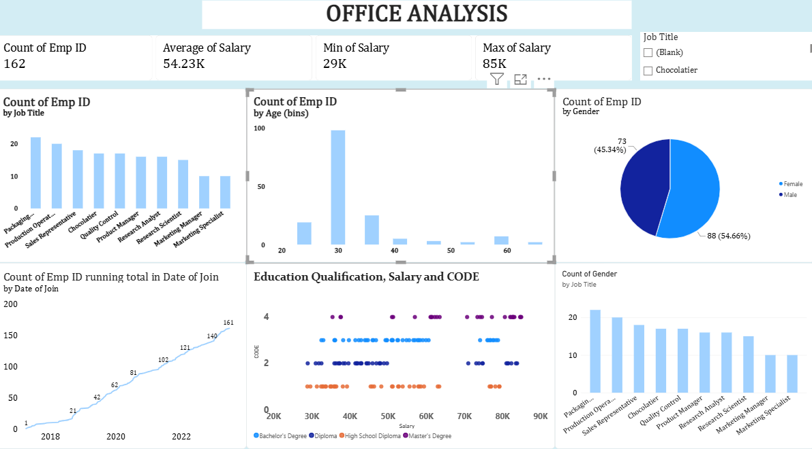

# Employee Data Insights | Workforce Intelligence Dashboard

An employee analytics project focused on transforming raw workforce data into meaningful insights using Microsoft Excel and Power BI.

---

## 1. Project Overview

**Employee Data Insights** is a data analytics project designed to explore workforce information and identify patterns in employee demographics, job roles, salary distribution, educational qualifications, age groups, and joining trends.

The project follows a structured analytical workflow, beginning with raw data inspection and cleaning in Excel, followed by data analysis and interactive visualization in Power BI.

The final dashboard consolidates key workforce metrics and visual reports to provide a comprehensive overview of employee information.

### Project Highlights

- Raw employee dataset inspection and preparation.
- Data cleaning and validation using Microsoft Excel.
- Workforce analysis across different employee attributes.
- Interactive dashboard development using Power BI.
- KPI-based reporting and data visualization.
- Analytical insights into workforce composition and salary patterns.

---

## 2. Project Objectives

The primary objectives of this project are:

1. Analyse employee distribution across different job titles.
2. Understand workforce composition through gender and age-group analysis.
3. Evaluate salary distribution and compensation patterns.
4. Examine employee educational qualifications.
5. Analyse employee joining trends over time.
6. Compare gender distribution across different job roles.
7. Present workforce metrics through an interactive analytical dashboard.

---

## 3. Dashboard Preview

The following dashboard provides a consolidated view of workforce metrics and employee analytics.



**Dashboard:** [View Full Dashboard](RESULT/DASHBOARD.png)

---

## 4. Key Performance Indicators (KPIs)

The dashboard highlights important workforce metrics to provide a quick overview of the employee dataset.

| KPI | Value | Description |
|---|---:|---|
| Total Employees | 161 | Total valid employee records |
| Average Salary | 54.23K | Average salary across employees |
| Minimum Salary | 28.9K | Lowest recorded employee salary |
| Maximum Salary | 85K | Highest recorded employee salary |
| Female Employees | 88 | Total female employees |
| Male Employees | 73 | Total male employees |

### KPI Interpretation

**Total Employees:** Represents the overall workforce size based on the cleaned dataset.

**Average Salary:** Indicates the average compensation across all valid employee records.

**Minimum Salary:** Identifies the lowest salary recorded in the dataset.

**Maximum Salary:** Identifies the highest salary recorded in the dataset.

**Gender Distribution:** Provides an overview of workforce composition by gender.

*Note: KPI values represent the cleaned dataset. Salary units follow the source dataset.*

---

## 5. Dashboard Analysis and Visualizations

The dashboard explores employee information through the following analytical dimensions:

### 5.1 Employee Distribution by Job Title

Analyses the number of employees working in different job roles.

**Purpose:**
- Identify job roles with higher employee representation.
- Understand workforce allocation across positions.
- Compare employee counts across different designations.

### 5.2 Age Group Analysis

Examines employee distribution across different age categories.

**Purpose:**
- Understand the workforce age composition.
- Identify the most represented age groups.
- Compare employee distribution across age segments.

### 5.3 Gender Distribution Analysis

Provides a comparison of male and female employees.

**Purpose:**
- Understand gender representation.
- Evaluate the overall workforce composition.
- Identify differences in employee distribution.

### 5.4 Employee Joining Trends

Visualizes cumulative employee joining patterns over time.

**Purpose:**
- Understand employee joining patterns.
- Examine workforce growth over the recorded period.
- Identify changes in employee joining activity.

### 5.5 Education and Salary Analysis

Examines salary distribution across educational qualification categories.

**Purpose:**
- Compare salary patterns across educational backgrounds.
- Understand compensation distribution.
- Explore the relationship between qualifications and salary.

### 5.6 Gender Distribution by Job Title

Compares male and female employee representation across different job roles.

**Purpose:**
- Analyse gender distribution within individual job categories.
- Compare workforce composition across positions.
- Identify variations in gender representation.

### 5.7 Interactive Job Title Filtering

Allows users to filter dashboard information by job title.

**Purpose:**
- Explore specific job categories.
- Compare filtered workforce metrics.
- Improve dashboard navigation and analysis.

---

## 9. Tools and Technologies

| Tool / Technology | Application |
| Microsoft Excel | Data inspection, cleaning and preparation |
| Git | Version control |

## 10. Project Workflow

The project follows a structured data analytics workflow:

```text
        |
        v
Data Inspection
        v
        |
        v
Cleaned Employee Dataset
        |
        v
Data Analysis
        |
        v
Power BI Dashboard Development
        |
        v
KPI Analysis and Visualization
        |
        v
Workforce Insights
```

---

## 11. Repository Structure

The repository is organized into separate directories to maintain a clear distinction between source data, cleaned data, analysis files, and final outputs.

```text
employee-data-insights/
│
├── ANALYSIS/
│   └── powerbi_project/
│       └── PROJECTANALYIS.pbix
│
├── CLEAN DATA/
│   └── CLEAN DATA.xlsx
│
├── RAW DATA/
│   └── officeanalysis.xlsx
│
├── RESULT/
│   ├── DASHBOARD.png
│   ├── REPORT 1.png
│   ├── REPORT 2.png
│   ├── REPORT 3.png
│   ├── REPORT 4.png
│   ├── REPORT 5.png
│   └── REPORT 6.png
│
└── README.md
```

### Directory Description

| Directory | Description |
|---|---|
| `RAW DATA/` | Contains the original employee dataset. |
| `CLEAN DATA/` | Contains the cleaned and prepared employee dataset. |
| `ANALYSIS/` | Contains the Power BI project file used for analysis and dashboard development. |
| `RESULT/` | Contains the final dashboard preview and analytical report screenshots. |
| `README.md` | Provides project documentation and usage information. |

---

## 12. How to Explore the Project

To explore the project locally:

1. Clone or download this repository.
2. Open the `RAW DATA` folder to access the original dataset.
3. Open the `CLEAN DATA` folder to review the prepared dataset.
4. Navigate to `ANALYSIS/powerbi_project/`.
5. Open `PROJECTANALYIS.pbix` using Microsoft Power BI Desktop.
6. Explore the dashboard, visualizations, and available filters.

**Prerequisite:** Microsoft Power BI Desktop is required to open and interact with the `.pbix` project file.

---

## 13. Future Enhancements

The project can be extended through additional analytical capabilities:

- Integrate SQL for structured employee data querying.
- Use Python for advanced exploratory data analysis.
- Develop additional Power BI reports and interactive dashboards.
- Introduce advanced DAX measures for deeper workforce analysis.
- Expand the analysis with additional HR performance metrics.

---

## 14. Conclusion

The Employee Data Insights project demonstrates how raw employee information can be transformed into structured, meaningful workforce insights through data cleaning, analysis, and visualization.

By combining Microsoft Excel and Power BI, the project provides an analytical view of employee demographics, job roles, salary patterns, educational qualifications, and joining trends.

It also demonstrates practical skills in data preparation, data visualization, KPI reporting, and business-oriented analytical thinking.

---

**Project Domain:** Data Analytics | HR Analytics | Workforce Intelligence

**Tools:** Microsoft Excel | Power BI | Power Query | Git | GitHub

**Project Type:** Data Cleaning, Analysis and Dashboard DevelopmentData Cleaning and Preparation
        |
Raw Employee Dataset

---
| GitHub | Project documentation and repository management |
| Power BI Desktop | Data analysis and dashboard development |
| Power Query | Data transformation and preparation |
| Power BI Visualizations | Interactive reporting and graphical analysis |
|---|---|

---

## 6. Dataset Overview


These findings provide a descriptive understanding of the available workforce data.
- Salary values vary across the employee records.
- Joining-date analysis provides an overview of workforce joining patterns.
The project uses two Excel datasets:

| Dataset | File | Purpose |
- Packaging Associate is the most represented job title in the dataset.
- Bachelor's Degree is the most frequently recorded educational qualification.
|---|---|---|
| Raw Dataset | `officeanalysis.xlsx` | Original employee records |
| Cleaned Dataset | `CLEAN DATA.xlsx` | Prepared employee records for analysis |


- Female employees represent a slightly higher proportion of the workforce.
The cleaned dataset contains **161 employee records and 10 columns**.
| Average Salary | Approximately 54.23K |
| Salary Range | 28.9K – 85K |

### Business Interpretation

### Data Dictionary

| Column Name | Description |
|---|---|
| Education | Bachelor's Degree is the most common qualification (49 employees) |
---
| Job Role | Packaging Associate has the highest employee count (22) |
| Gender Distribution | 88 female and 73 male employees |
| Female Workforce Share | Approximately 54.66% |
| Male Workforce Share | Approximately 45.34% |
|---|---|
| Workforce Size | 161 valid employees |
The analysis highlights the following observations:

| Analytical Area | Finding |

## 8. Key Analytical Findings

| Name | Employee name |
The cleaned dataset was subsequently used for employee analysis and visualization.

| Emp ID | Employee identification number |
| Gender | Employee gender |
- Organized the cleaned data for dashboard development.

| Education Qualification | Educational background |
- Verified employee ID uniqueness.
- Prepared the cleaned dataset for further analysis.
| Date of Join | Employee joining date |
| Job Title | Employee designation |
| Salary | Employee salary |
- Retained 161 valid employee records.
| Age | Employee age |
| Leave Balance | Available leave balance |
- Removed 838 invalid placeholder rows.
| First Characters | Helper column containing the first character of employee names |

---
- Identified placeholder records containing the text `null`.

## 7. Data Cleaning and Preparation

Data cleaning is an important stage of this project because the quality of the dataset directly affects analytical results.

- Inspected the original employee dataset.

